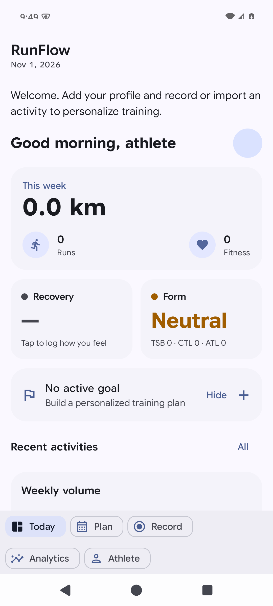
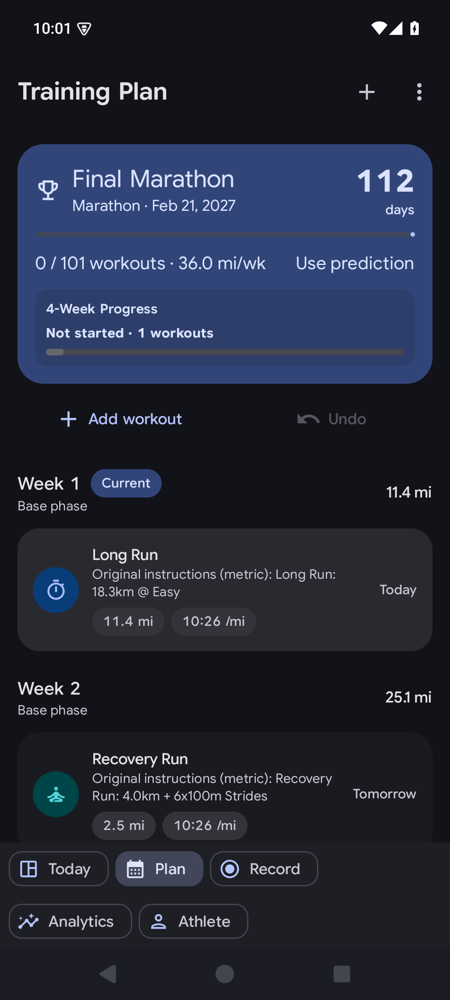

<h1 align="center">RunFlow</h1>

<p align="center"><strong>Train with a plan. Understand your progress.</strong><br>A self-hosted training platform for Android and the web.</p>

<p align="center">
  <a href="#get-started">Get started</a> ·
  <a href="android/README.md">Android app</a> ·
  <a href="docs/README.md">Documentation</a> ·
  <a href="https://github.com/thies2005/RunFlow/releases">Releases</a>
</p>

RunFlow brings training plans, workout execution, performance analytics, and recovery tracking together for runners, cyclists, swimmers, and triathletes. The native Kotlin/Compose Android app and Next.js web platform share one backend. Android also supports on-device planning when no server is configured.

## What you can do

| | Features |
|---|---|
| **Plan your training** | Build and adapt plans, organize a training calendar, and edit structured workouts. |
| **Record and review** | Follow guided workouts and review running and cycling performance. |
| **Track recovery** | Log health and wellness data, with Health Connect integration on Android. |
| **Connect your tools** | Use optional Strava sync, AI providers, and private or public MCP tools. |

## A look inside

Existing Android emulator captures from local QA; screens show test data and may differ from the latest build.

<table>
  <tr>
    <td align="center" width="50%"><br><strong>Your day</strong></td>
    <td align="center" width="50%"><br><strong>Your plan</strong></td>
  </tr>
</table>

## Planning, analytics and coaching

**Planning & coaching**
- AI-generated training plans for **17 race types** — 5K to 24-hour and backyard ultras, plus sprint→Ironman triathlons.
- **Structured Workouts v2**: nested step/repeat blocks with per-step pace / HR / power / RPE targets, planned TSS, and `.zwo` export for Zwift/MyWhoosh (with MyWhoosh catalog matching).
- Day-to-day **`/calendar`** view for executing plans, and **`/plan-advanced` studio** for hands-on editing: drag-and-drop weeks, phase blocks, week copy/paste, live PMC projection.
- Plan adaptation after races and threshold recalibration.

**Analytics**
- Running: VDOT & race predictions, **two-metric VO2max calibration** (best-effort VDOT from activities vs. Swain HR-based estimate), TRIMP load, CTL/ATL/TSB (PMC), grade-adjusted pace, 7-zone HR model.
- Cycling: power-stream sync from Strava, **eFTP**, MMP power curves, NP/IF/VI, bike TSS, efficiency factor & decoupling, split run/ride/combined PMC.

**Health & recovery**
- Health data (resting HR, HRV, sleep, body composition, nutrition, supplements, fasting) with a **daily readiness engine** and adapted-workout recommendations.
- Health Connect integration on Android; manual logging everywhere else.

**AI & automation**
- Multi-provider AI coach chat and activity feedback with **bring-your-own-key**, token metering, and daily quotas.
- Strava OAuth + webhook sync (including watts streams), push notifications, reminder e-mails.

**MCP — use RunFlow from Claude, Gemini or any MCP client**
- **Private MCP at `/mcp`** (Paid-Premium users): 16 coaching tools (read fitness/analytics, create & mutate plans and structured workouts) behind OAuth 2.1 with PKCE and dynamic client registration.
- **Public MCP at `/mcp/public`**: stateless plan generation, VDOT pace calculation and plan export URLs — no account needed, rate-limited to 10 requests/hour.

Full details: [docs/MCP_API.md](docs/MCP_API.md).

## Architecture

| Layer | Technology |
|---|---|
| Web app + API | Next.js 15 (App Router) + React 19, server components + service-layer architecture |
| Database | PostgreSQL 16 + Prisma 7 (60 models) |
| Auth | NextAuth v5 (credentials + Strava OAuth); JWT for the mobile API; OAuth 2.1/PKCE for MCP |
| Caching / rate limiting | Redis 7 (optional — degrades gracefully without it) |
| Styling | Tailwind CSS 4 |
| Monitoring | Sentry |
| Android app | Kotlin 2.2, Jetpack Compose, Room v13 (offline-first), WorkManager, Health Connect |

The **plan engine is the web engine only** (server-side when signed in, on-device port otherwise). The classic on-device Daniels engine was removed in v2.3.0.

## Repository layout

```
Web/          Next.js app: UI (src/app), API routes (src/app/api), engines (src/lib),
              Prisma schema & migrations (prisma/), Docker & deploy files
android/      Native Kotlin/Compose Android app (Gradle, Room, Health Connect)
docs/         Project documentation — start at docs/README.md for the index
```

## Get started

```bash
cd Web
cp .env.example .env      # then set at minimum:
                          #   NEXTAUTH_URL, NEXTAUTH_SECRET, JWT_SECRET, ENCRYPTION_KEY,
                          #   POSTGRES_PASSWORD and SMTP settings for email login
docker compose up -d --build
docker compose exec app npx prisma migrate deploy
```

Set `NEXTAUTH_URL` to your public HTTPS origin (for example `https://training.example.com`), with no path, query, or credentials. Configure your reverse proxy's TLS certificate and forward requests to the app; the Android server URL must use the same origin. Plain HTTP is supported only for localhost development. Configure SMTP for email sign-in; it does not require Strava. Strava is optional: register your own application and set its callback to `https://training.example.com/api/auth/strava/callback`, then provide `STRAVA_CLIENT_ID` and `STRAVA_CLIENT_SECRET`. AI features require separately configured providers and network access.

The optional Cloudflare tunnel can be started with `docker compose --profile tunnel up -d` after setting `TUNNEL_TOKEN`; it is not needed when using a reverse proxy.

- The compose file publishes `127.0.0.1:3000` (app) and `127.0.0.1:5434` (Postgres) on loopback only — put a reverse proxy or Cloudflare Tunnel in front.
- Optional Redis (rate limiting + caches) and automated `pg_dump` backups are configured in the compose file.
- For Coolify deployments see [COOLIFY_DEPLOY.md](COOLIFY_DEPLOY.md) (adds a one-shot migrator, reminder and feedback-queue cron services).
- Full environment-variable reference and operations guide: [Web/DOCUMENTATION.md](Web/DOCUMENTATION.md).

## Development

### Web (from `Web/`)

```bash
npm install
npx prisma generate && npx prisma db push   # local Postgres via DATABASE_URL
npm run dev                                  # next dev --turbo on :3000
npm test                                     # Jest unit tests
npm run test:integration                     # API integration tests
npm run test:e2e                             # Playwright (Chromium)
npm run lint
```

### Android (from `android/`)

Requires JDK 17; SDK path is set in `android/gradle.properties`.

```bash
./gradlew assembleRelease        # release APK (signing via gitignored key.properties)
./gradlew :app:compileDebugKotlin  # compile check
./gradlew testDebugUnitTest      # unit tests
```

Pre-push checklist for Android changes: compile check + unit tests, both green.

## Documentation

| Document | Contents |
|---|---|
| [docs/README.md](docs/README.md) | **Index of all documentation** (current vs. archived) |
| [Web/DOCUMENTATION.md](Web/DOCUMENTATION.md) | Full web reference: architecture, data models, metrics formulas, API, deployment |
| [docs/MCP_API.md](docs/MCP_API.md) | MCP servers: tools, OAuth 2.1 flow, client setup for Claude/Gemini |
| [Web/MOBILE_API.md](Web/MOBILE_API.md) | Native Android app ↔ server protocol (JWT, sync, App Links) |
| [android/README.md](android/README.md) | Android app: features, architecture, build & signing |
| [COOLIFY_DEPLOY.md](COOLIFY_DEPLOY.md) | Production deployment on Coolify |
| [CODING_STANDARDS.md](CODING_STANDARDS.md) | Code conventions for web and Android |
| [AGENTS.md](AGENTS.md) | Notes for coding agents working in this repo |

## License

SPDX-License-Identifier: GPL-3.0-or-later

RunFlow is licensed under the GNU General Public License, version 3 or (at your
option) any later version. See [LICENSE](LICENSE). Existing third-party code
retains its respective notices and licenses.
