# RunFlow Android: QA follow-up retest

Date: **1 November 2026** · Follow-up to the [31 October audit](../2026-10-31/REPORT.md). This document records implementation and automated/source evidence. Device observations and screenshots are recorded below. Source/unit evidence and direct runtime evidence are distinguished.

## Final automated verification

Final serial command: `./gradlew :app:compileDebugKotlin testDebugUnitTest lintDebug assembleRelease --no-parallel` — **BUILD SUCCESSFUL**. All **534 unit tests passed**, with zero failures/errors. Kotlin compilation and lint passed; the release APK signature verified with apksigner. Warnings remain; this is not a warning-free build.

See [final Gradle log](retest/evidence/gradle-final.txt). Earlier overlapping Gradle processes caused intermediate-cache failures; those runs are not counted as verification. The final successful runs were serialized after worker edits stopped.

The retest found and fixed two additional correctness bugs: calibration multiplied metre distances by 1,000, blocking a valid 50-minute 10K; stationary strength sessions were silently discarded by a GPS-distance save threshold. Both now have regression tests. Calibration copy now correctly says Required when history is absent.

## Observed emulator results

The final release was installed on RunFlow_FixTest_API35, Android 15, 1080×2400, 420 dpi. Earlier captures used the preceding release during iterative diagnosis; captures 29 onward use the final release. Evidence filenames are raw chronological capture identifiers; some failed automation attempts captured the preceding screen. The curated screenshots below are the accepted evidence, not every raw capture.

| Step | Observed result | Evidence |
|---|---|---|
| 1. Fresh offline install | Zero runs/distance, generic athlete, no invented body measurements | 04, 05 |
| 2. Permission setup | Idle recording screen remains behind optional permission dialogs; no elapsed timer | 15, 16 |
| 3. Recording controls | Full-width Pause/Lap/Finish and Resume labels remain readable | 17, 20, 35 |
| 4. Finish confirmation | Time stayed 0:04 across separate captures, then saved as 0:04 | 36–38 |
| 5. Stationary strength | Correct session title/time display; zero-distance activity successfully saved | 35, 38 |
| 6. New calibration | Required own result; 10K 0:50:00 yields VDOT 40.0 and Continue works | 30, 31 |
| 7. Target mode | Prediction explicitly selected; fixed target is a separate action | 32 |
| 8. Weekly schedule | Sunday visible and selected; long-run/quality summary present | 33 |
| 9. Created plan | 101 workouts generated; neutral Not started; explicit Use prediction | 34 |
| 10. Imperial units | Converted distance/pace chips; unmodified metric instructions explicitly labeled | 34 |
| 11. Settings | Units/theme reachable without a large diagnostic panel | 23, 24 |
| 12. Large text and dark mode | At 150%, navigation words remain whole; white status icons readable on dark background | 29 |
| 13. Recovery defaults | Not answered is explicit, Use 5/10 available, empty Save disabled; explicit selection permitted saving | 27 |
| 14. Chart context | Numeric fitness scale and accessibility range are exposed | 40 |

A System UI-not-responding dialog occurred during initial emulator startup under host build load; Wait recovered it. It was Android System UI, not a RunFlow crash. No RunFlow crash appeared in the collected crash buffer. The recovery reopening automation landed in Analytics instead of the intended form, so persistence after reopening is **not claimed as manually verified**. Fixed-target creation, triathlon, full denied-permission matrix, populated nonzero chart scales, legacy demo upgrade/reset, 200% text and physical-device behavior remain follow-up acceptance coverage.

## Finding-by-finding evidence

| Finding | Implementation and automated/source evidence | Additional acceptance coverage |
|---|---|---|
| **F01** Fresh install/demo | Automatic startup seeding was removed from `RunFlowApp`. Repository analytics excludes `isDemo` activities; the wizard does not prefill legacy demo profile values. Dashboard and Athlete warn when legacy sample activities remain and Settings offers a local reset. Calibration requires a user result or available history for flows containing that step. | Fresh offline install, legacy seeded upgrade and reset; verify no sample identity/history influences a real plan. There is no separate Explore demo mode. Generic profile defaults still exist in some calculations; unconfigured values are not a substitute for the athlete's measurements. |
| **F02** Metric rounding | Today uses `Format.roundedIntOrDash` for fitness and form values. `AuditRegressionTest` checks positive and negative rounding. | Compare Today and Analytics with the same underlying positive and negative values. |
| **F03** Block-load basis | `ComplianceCalculator.displaySummary` identifies unavailable load and distance, duration or completion fallback; future untouched sessions use a neutral Not started status. `AuditRegressionTest` covers distance fallback and future sessions. | Inspect generated and completed plans with each basis and verify labels, values and readable layout. |
| **F04** Recording labels | Recording actions use separate full-width controls with minimum height rather than a narrow three-button row. | Check Finish, Pause, Resume and Lap / Next on narrow screens and at 1.0, 1.3, 1.5 and 2.0 font scales. |
| **F05** Permission timing | A pending start is resumed from the permission result callback after required location is granted; the service is not started before pending requests return. | Exercise permission grant, denial and retry for location and optional permissions; confirm no timer runs behind dialogs. |
| **F06** Finish endpoint | Finish begins a frozen finish state; dismiss/Keep going cancels it, while save uses the frozen endpoint. `AuditRegressionTest` checks paused controller time and distance do not advance. | Wait at least 30 seconds in confirmation and check saved time/distance; test Keep going, dismissal and already-paused sessions. |
| **F07** Sport-specific recording copy | Record entry describes the selected activity and derives the accessible start label; strength and outdoor swim have specific explanations, and auto-pause/voice-coach text varies. | Check each activity's visible and spoken labels, permission rationale and actual recording behavior. Strength still requires location. |
| **F08** Units in instructions | Structured distance and pace chips use selected units. `Format.workoutInstructions` labels metric-bearing original instruction text in imperial mode; `AuditRegressionTest` covers preservation and labeling. | Inspect Today, Plan and Record in both unit systems. Original instruction text remains metric, including generated text where provenance cannot be established; it is labeled rather than converted. |
| **F09** System bars | `RunFlowTheme` sets status and navigation bar icon appearance from the resolved app theme. | Check app/system light and dark combinations and modal sheets on device. |
| **F10** Large text navigation | Bottom navigation and Analytics tabs use wrapping chip layouts with single-line labels. | Verify readable, reachable navigation at 150% and 200% text and on narrower screens. |
| **F11** Selected-card contrast | Wizard event cards use `onSecondaryContainer` for selected content and expose selected semantics. | Measure selected card text/icon contrast in light and dark themes and verify selection without relying only on color. |
| **F12** Long-run day | Day selectors wrap; the schedule shows a text summary of long-run and quality days. | Verify all seven choices, default Sunday, selection changes and confirmation before creation at normal and large text sizes. |
| **F13** Recovery answers | Unanswered sliders display Not answered, offer an explicit Use value action, and Save requires a change. | Confirm intentional 5/10, untouched empty Save, editing and clearing existing values, and persistence after reopening. |
| **F14** Diagnostics | Troubleshooting is collapsed and moved below common settings; the technical log remains available on expansion. | Verify page scrolling over collapsed and expanded sections and access to Units and Theme. |
| **F15** Chart context | Fitness chart adds numeric scale and accessible range; activity streams identify sampling range, elevation availability/constant values and session moving time. | Check empty, constant and populated series, axis readability and screen-reader descriptions against sample duration. |
| **F16** Target choice | Running and triathlon target steps distinguish prediction from a fixed target and offer an explicit Set target action; plan header indicates prediction when no target is stored. | Create plans with untouched prediction and explicit target for both disciplines; compare displayed and persisted values, including rounding. |

## Coverage limits

Authenticated email/Strava flows, server sync and conflict handling, Health Connect imports, real GPS and background recording, battery behavior, and real-device accessibility remain outside the automated evidence. They need the staging-account and physical-device checks described in the original audit. Screenshots and UI trees alone do not establish TalkBack, switch-access, contrast or full accessibility compliance.

## Curated screenshot evidence

### 04-dashboard

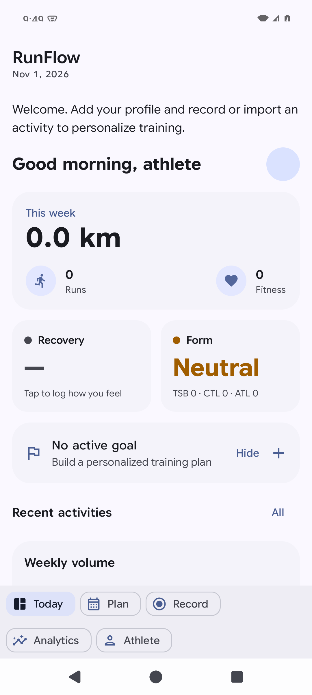

### 05-athlete

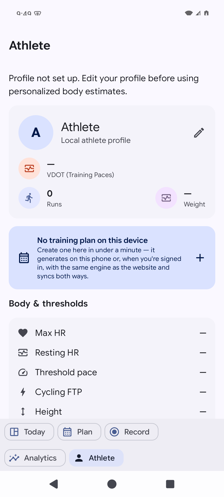

### 07-wizard

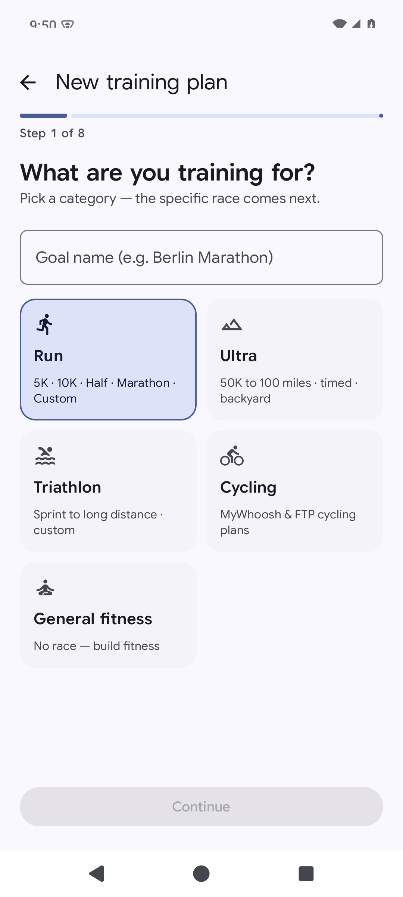

### 13-strength

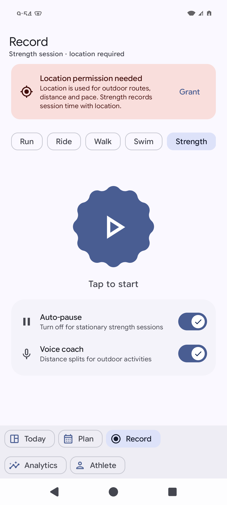

### 15-before-start-activity-permission

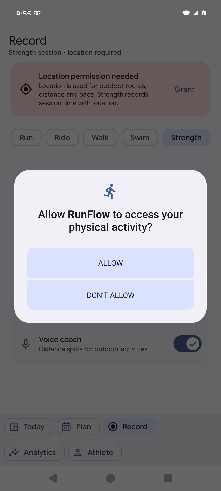

### 16-before-start-notification

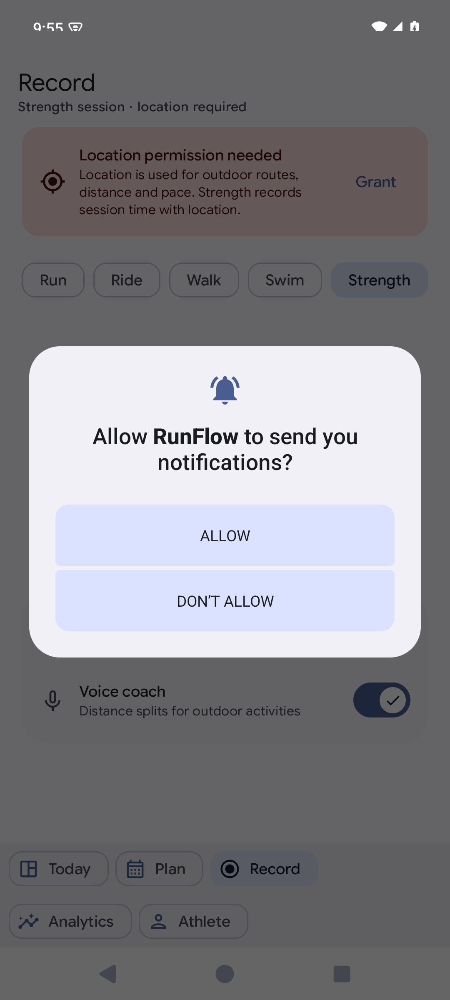

### 20-paused

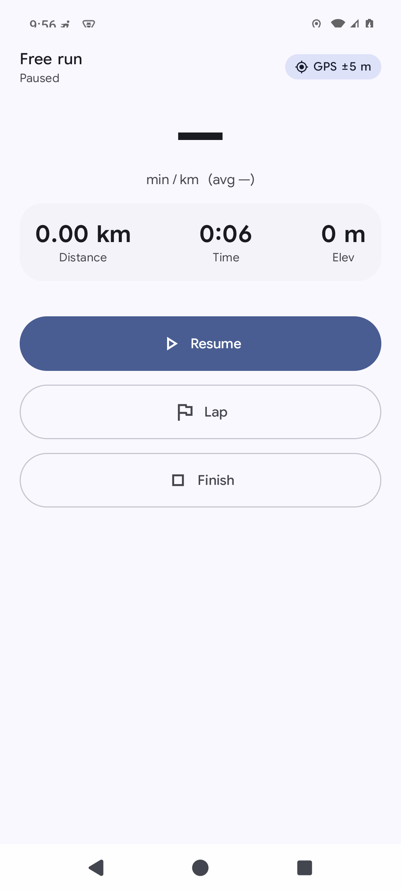

### 23-settings

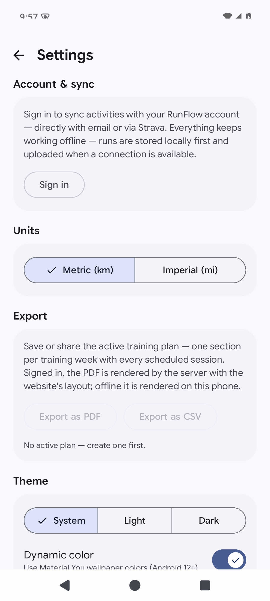

### 27-unanswered

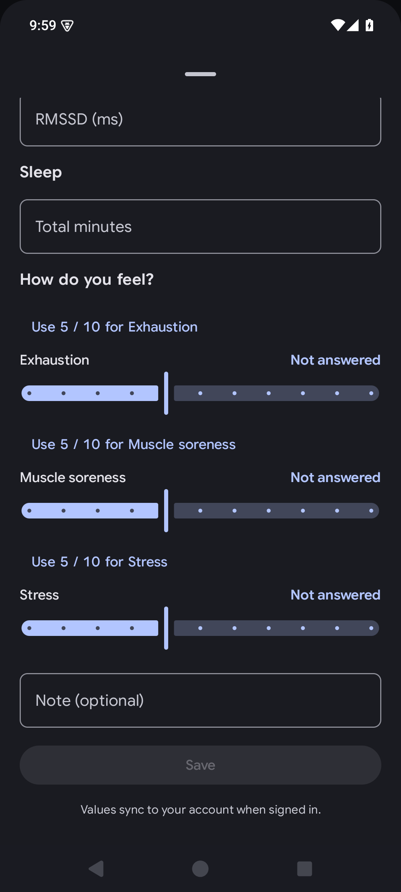

### 29-final-large-analytics

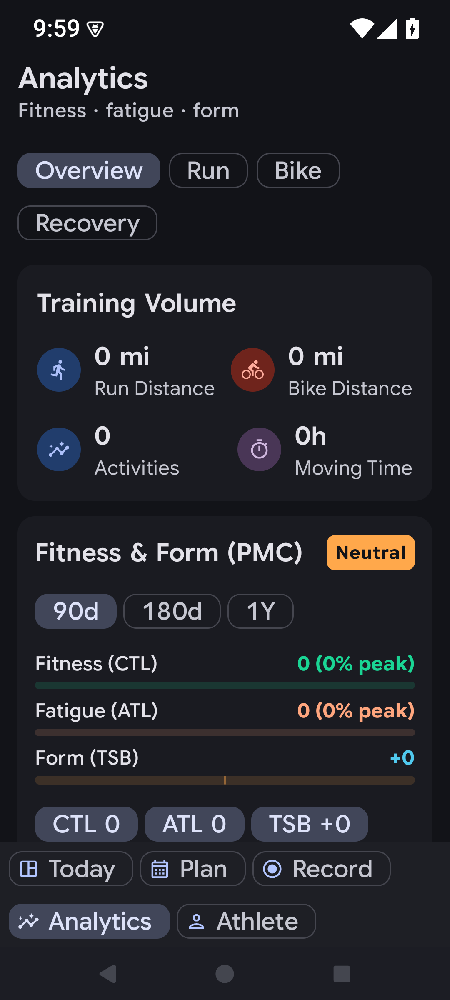

### 30-final-calibration-required

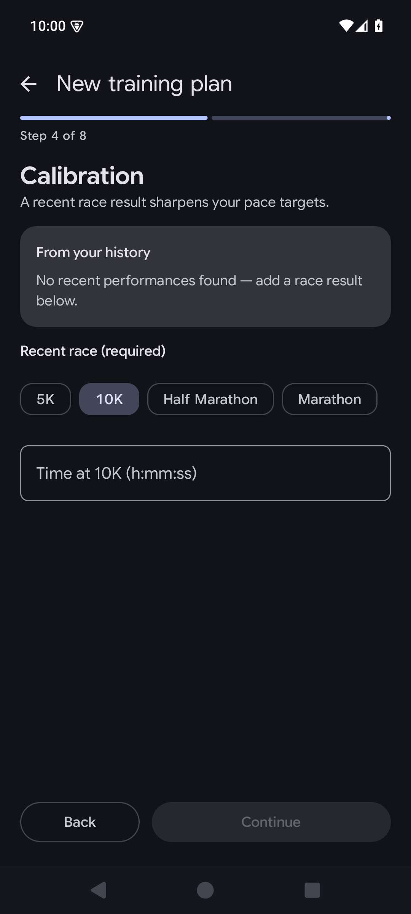

### 31-calibration-valid

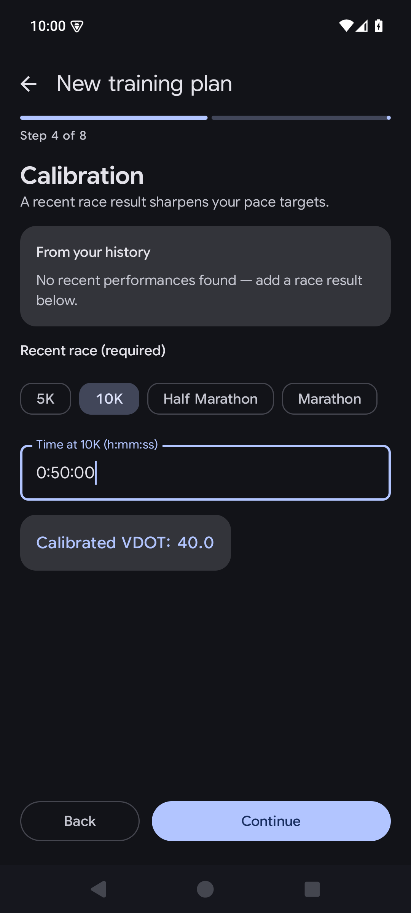

### 32-prediction-mode

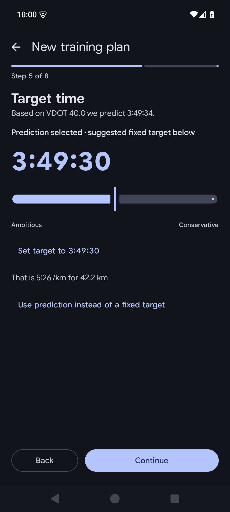

### 33-final-schedule

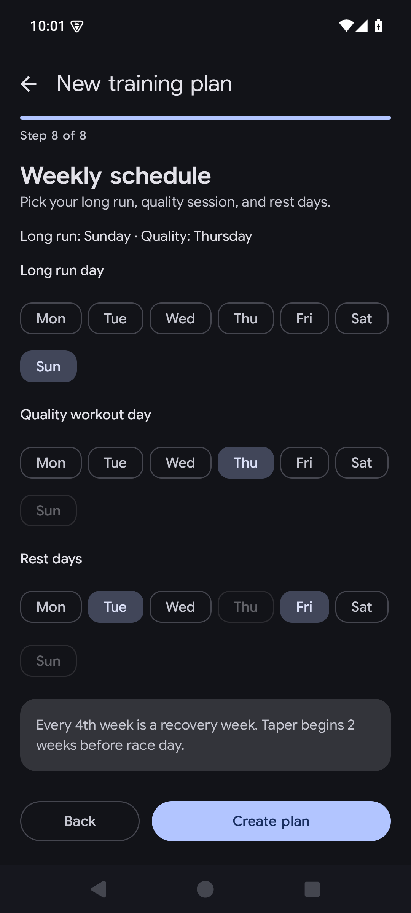

### 34-final-plan

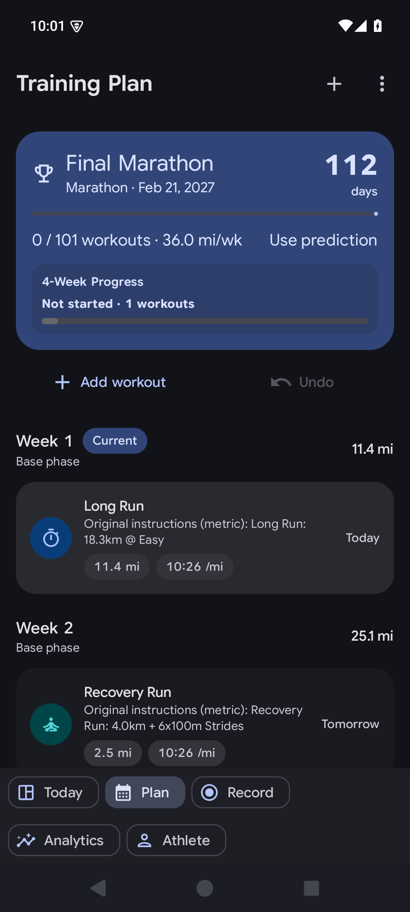

### 35-final-strength

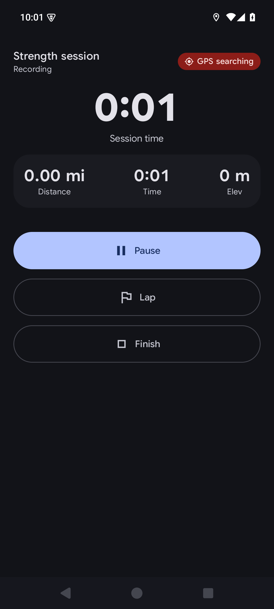

### 36-final-finish

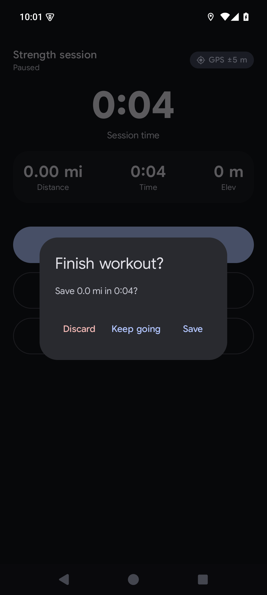

### 37-final-frozen

### 38-strength-saved

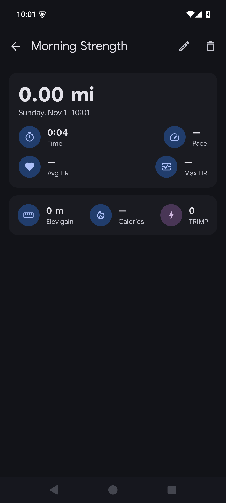

### 40-chart-scale

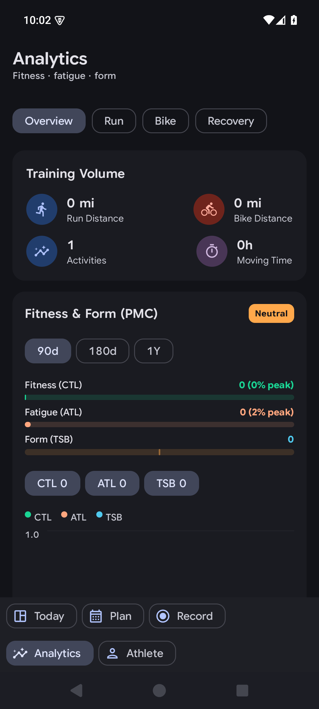

## Review providers and limits

Three GPT-6.1 Terra subagents at medium reasoning implemented/reviewed scoped changes as requested. The primary chat integrated their work and ran final verification. The newly supplied GLM/Gemini MCP review tools were not callable in this session; no GLM or Gemini sign-off is claimed. Unrelated Web edits were preserved. No changes were committed or pushed.
